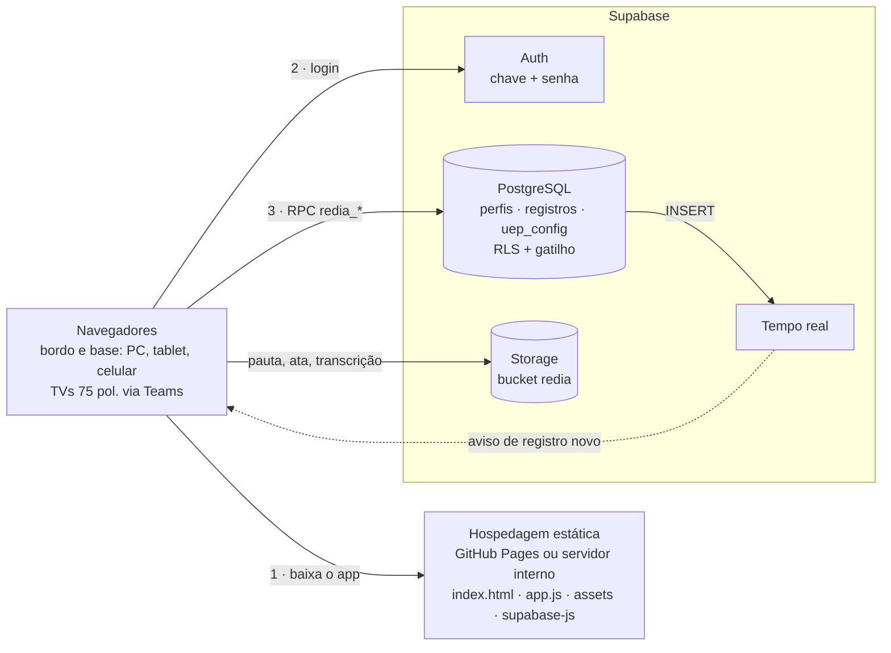

# Arquitetura da REDIA V1.0

## Modelo de dados

**Registros só de acréscimo (event sourcing).** Toda ação na REDIA vira uma linha em `public.registros`: um valor corrigido, uma sugestão aprovada, uma conclusão, o congelamento, uma demanda. O app monta o estado do dia relendo os registros em ordem. É o mesmo formato JSON do protótipo v0.8 (`id`, `tipo`, `data`, `uep`, `criadoEm`, `gravadoEm`, `autor`, `payload`, `escopo`), então exportações do protótipo podem ser importadas.

| Coluna | Uso |
|---|---|
| `seq` | sequência global (sincronização incremental) |
| `id` | id do registro no app (único por UEP) |
| `uep`, `data`, `escopo` | `dia` (REDIA do dia) ou `demandas` (atravessam os dias) |
| `tipo` | sugestao, decisao, comentario, valor, lista, servico, item, demanda, atualiza, remove, aceite, congelamento, reabertura, anexo, ata, conclusao, notificacao, selecao |
| `criado_em` | hora exibida (vem do app; segue o horário simulado da demonstração) |
| `gravado_em` | **hora oficial** carimbada pelo servidor; define a ordem dos registros (R-01) |
| `autor`, `autor_id`, `autor_chave` | autoria a partir do perfil (dados de exemplo mantêm o rótulo fictício, mas `autor_chave` é sempre a chave real) |
| `payload` | conteúdo (JSON) |

## Funções (RPC) usadas pelo app

| Função | O que faz |
|---|---|
| `redia_meu_perfil()` | perfil do usuário logado (chave, nome, posto, coordenação, UEP, admin, troca de senha pendente) |
| `redia_senha_trocada()` | marca a troca de senha do 1º acesso |
| `redia_carregar(uep, data, campos_mes)` | registros do dia, demandas e, dos dias anteriores do mês, só os valores usados nos acumulados (D-43) |
| `redia_novos(uep, seq)` | o que entrou depois da última leitura |
| `redia_gravar(lote)` | grava 1 a 2000 registros; ignora ids já existentes (importação idempotente) |
| `redia_config_ler / redia_config_salvar` | configuração da UEP |

## Sincronização

1. No login, `redia_carregar` traz o dia.
2. A cada gravação, o registro devolvido pelo servidor (com autoria e hora oficial) entra no cache local.
3. O canal de **tempo real** avisa quando há INSERT na UEP; o app chama `redia_novos` (250 ms de espera para agrupar).
4. Leitura periódica de segurança: a cada 15 s sem tempo real, ou a cada 60 s com ele, e também ao voltar para a aba e quando a rede volta.
5. Se o usuário está digitando, a tela não é redesenhada: aparece o aviso "Há registros novos…".

## Congelamento da pauta

- **No app:** antes de gravar uma alteração, sincroniza e confere se o dia foi congelado (R-03).
- **No servidor:** o gatilho `redia_registros_antes_inserir` faz o seguinte:
  - pega um bloqueio consultivo por UEP+dia;
  - lê o último `congelamento`/`reabertura` do dia;
  - recusa a curadoria se a pauta estiver congelada.
- Passam com a pauta congelada: demanda, anexo, ata, reabertura, notificação e qualquer registro de escopo `demandas`.
- O congelamento grava o *snapshot* da pauta no próprio registro e uma cópia em `Storage/redia/<UEP>/<AAAA>/<MM>/<DD>/pauta_congelada_<hhmmss>.json`.

## Arquivos (Storage)

- Bucket privado `redia`, organizado em `<UEP>/<AAAA>/<MM>/<DD>/<nome>_<hhmmss>.<ext>`.
- O sufixo de hora evita sobrescrever: o bucket é só de acréscimo.
- O registro `anexo` ou `ata` guarda o caminho, e o botão **Baixar** busca o arquivo com a sessão do usuário.

## Modos do app

| Modo | Quando | Dados |
|---|---|---|
| Nuvem | `config.js` com `supabaseUrl` e `supabaseAnonKey` | Supabase |
| Demonstração | sem configuração, ou `?demo=1` na URL | navegador (localStorage), usuários fictícios |

O modo pasta compartilhada (OneDrive/SharePoint) e a ponte de arquivos com o celular do protótipo v0.8 não existem na V1.0: na versão web, tablets e celulares acessam a mesma base diretamente.

## Montagem (`build.py`)

- **`dist/` (web):**
  - `index.html` com CSP restrita: scripts só do próprio site; conexões só com o Supabase configurado;
  - `app.js`/`app.css` com código de versão no endereço;
  - `assets/`, `vendor/supabase-2.112.4.min.js`, `config.js`, `robots.txt` (não indexar) e `.nojekyll`.
- **`dist-unico/redia.html`:** tudo embutido (mídia em base64), para homologação ou distribuição por arquivo.
- **Bibliotecas:** nenhuma dependência em tempo de execução além do supabase-js (servido junto, sem CDN, o que funciona em rede interna sem acesso a CDNs públicos).
